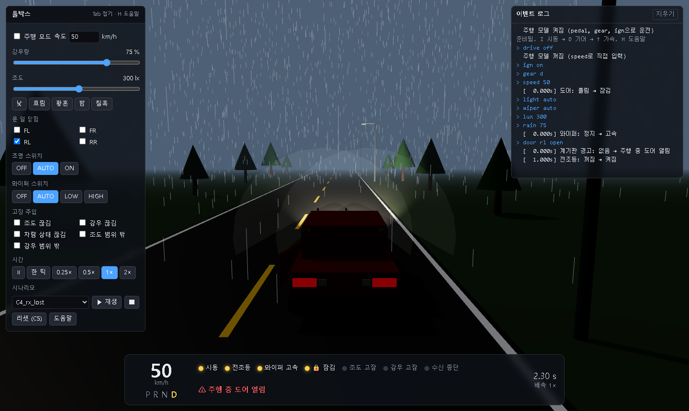

# vehicle-body-control

가상 차량의 차체 편의 기능(조명, 와이퍼, 도어 잠금, 계기판 경고)을 C로 구현하고, 브라우저 시뮬레이터에서 운전하며 확인하는 팀 프로젝트입니다.
요구사항의 근거는 고객 사양서 **VBC-SRS-001 v1.0**(`docs/spec/VBC-SRS-001_v1.0.pdf`)입니다.
판단은 전부 C 코어가 하고, 화면은 그 결과를 그리기만 합니다.



## 팀
| 이름 | GitHub | 담당 |
|---|---|---|
| 김성진 (팀장) | @Dokbudoli | B 조명 (L1~L6) |
| 이태식 (GitHub 관리) | @taesik-lee303 | A 코어·통합 (C1~C5), F 입력/시연·주행 (R1~R5) |
| 이지윤 | @Kenshi00 | C 와이퍼 (W1~W5) |
| 김의현 | @uihyun-kim | D 도어·잠금 (D1~D3) |
| 김주형 | @kjh082427 | E 계기판 (D4~D5) |

만든 사람과 검증하는 사람은 다릅니다. 역할별 검증자는 [docs/roles.md](docs/roles.md).

## 구현 범위
| 구분 | 요구사항 | 상태 | 확인 |
|---|---|---|---|
| 공통 (필수) | C1~C5: N초 연속, 센서 고장, 유효한 속도, 수신 중단, 초기 상태 | 구현 | `make test`, 시나리오 |
| 조명 (필수) | L1~L6, 우선순위 L1 > L5 > L4 > L6 > L2·L3 | 구현 | `make test`, `Z01` |
| 와이퍼 (필수) | W1~W5, 우선순위 W1 > W4 > W5 > W2·W3 | 구현 | `make test`, `Z02` |
| 도어·잠금·경고 (필수) | D1~D5 | 구현 | `make test`, `Z03` |
| 주행 (선택) | R1~R5: 시동·기어 제한, 가속·브레이크, 최고 속도 | 구현 | `make test`, `Z04` |
| 추가 기능 (실험) | 전방 레이더 맵·Stop & Go (사양서 밖, 가정 요구사항) | 구현 | `make test` (test_radar, test_stopgo) |

요구사항별 증명 기록과 AI가 틀린 곳은 [docs/verification.md](docs/verification.md)에 있습니다.

## 빠른 실행 (준비가 끝난 경우)
```bash
source ~/emsdk/emsdk_env.sh   # 새 터미널마다 한 번
make sim                      # C 코어를 브라우저용으로 빌드(make wasm)하고 서버 실행
```
Windows 브라우저에서 **http://localhost:8080/sim/** 을 엽니다. 종료는 터미널에서 `Ctrl+C`.

화면 오른쪽 이벤트 로그(입력한 명령, 출력 변화, 시나리오 ✔/✘)는 `make sim`을 띄운 터미널에도 그대로 찍힙니다.
```
> rain 75
  [ 12.350s] 와이퍼: 간헐 → 고속
```

## 처음 한 번 준비
Windows는 **WSL Ubuntu 안에서** 진행합니다 (저장소도 WSL 안, 예: `~/work/...`).

1. 기본 도구: `gcc`, `make`, `python3`
   ```bash
   sudo apt update && sudo apt install -y build-essential python3 git
   ```
2. 저장소 받기 (GitHub 관리자의 초대를 먼저 수락합니다)
   ```bash
   gh repo clone taesik-lee303/vehicle-body-control
   cd vehicle-body-control
   ```
3. Emscripten(emsdk) 설치: C 코어를 브라우저에서 돌리기 위한 컴파일러입니다. 약 1GB, 몇 분 걸립니다.
   ```bash
   git clone --depth 1 https://github.com/emscripten-core/emsdk.git ~/emsdk
   ~/emsdk/emsdk install latest
   ~/emsdk/emsdk activate latest
   ```
4. 확인
   ```bash
   make test                     # ALL TESTS PASSED 가 나오면 정상 (emsdk 없이도 됨)
   source ~/emsdk/emsdk_env.sh
   make sim
   ```

three.js와 지도·하늘·텍스처 자원은 저장소에 들어 있어 인터넷이 없어도 실행됩니다.
`sim/build/vbc.js`는 빌드 결과물이라 저장소에 없습니다. C 코드를 바꾸면 `make sim`(또는 `make wasm`)으로 다시 만들고 브라우저를 새로고침합니다.

## 시연 시나리오
요구사항 묶음별로 나눈 시나리오 4개입니다. 각 파일은 초기 상태(C5)에서 단독으로 재생되고, 모든 `expect`가 통과합니다.

| 파일 | 내용 | 확인하는 요구사항 (재생 순서) |
|---|---|---|
| `Z01_L_lighting.txt` | 조명 | L5 → L2 → L3 |
| `Z02_W_wipers.txt` | 와이퍼 | W5 → W2 → W3 |
| `Z03_D_doors.txt` | 도어·잠금·경고 | D1 → D2 → D3 → D4 → D5 |
| `Z04_R_drive.txt` | 주행 | R1 → R2 → R3 → R4 → R5 |

재생 방법은 세 가지이고, 판정 시각과 결과는 모두 같습니다.
- **화면**: 툴박스 **시나리오**에서 파일을 골라 ▶. 지금 확인하는 요구사항(파일의 `#@` 줄)이 이벤트 로그에 빨간색 `▶ L2 — ...`로 표시되고, `expect` 결과가 ✔/✘로 찍힙니다.
- **URL**: `http://localhost:8080/sim/?scenario=Z01_L_lighting.txt`
- **터미널**: `./build/vbc scenarios/Z01_L_lighting.txt` (전체는 `make scenarios`)

시나리오 문법(`ign on`, `rain 40`, `wait 1`, `expect wiper low` 등)은 [docs/console.md](docs/console.md)에 있습니다.

## 조작
| 키 | 동작 |
|---|---|
| `I` | 시동 켜기/끄기 (정지 상태에서만, R1) |
| `P` `R` `N` `D` | 기어 (정지 상태에서만, R2) |
| `↑` / `Shift` | 가속 / 강한 가속 |
| `↓` | 브레이크 (가속과 같이 누르면 브레이크 우선, R4) |
| `←` `→` | 핸들 (화면에서만 씀, 코어로 보내지 않음). 손을 떼면 가운데로 돌아오고, 빠를수록 덜 꺾임 |
| `L` / `W` | 조명 스위치 / 와이퍼 스위치 순환 |
| `1` ~ `4` | 도어 FL FR RL RR 열림/닫힘 |
| `Space` / `.` | 일시정지 / 일시정지 중 0.05초씩 진행 |
| `[` `]` | 배속 0.25 · 0.5 · 1 · 2 |
| `C` | 카메라: 추적 → 정면 → 위 → 측면 |
| `Tab` / `H` | 툴박스 접기 / 도움말 |
| `G` | Stop & Go 스위치 (실험 기능) |
| `S` / `F` | Stop & Go SET (지금 속도로 작동) / RES (재출발) |
| `-` `=` / `V` | Stop & Go 설정 속도 −10 / +10 km/h / 차간 시간 1.0 → 1.5 → 2.0 s |

처음에는 `I` → `D` → `↑` 로 출발해 보세요.

## 화면 구성
- **좌상단 툴박스**: 강우량, 조도(낮·흐림·황혼·밤·칠흑), 문 덜 닫힘, 조명·와이퍼 스위치, 고장 주입(조도·강우·차량 상태 끊김, 범위 밖 값), 시간(일시정지·배속), 시나리오 재생, 리셋(C5)
- **하단 계기판**: 속도, 기어, 시동·전조등·와이퍼·잠금 상태, 센서 고장·수신 중단 램프, 계기판 경고, 시뮬레이션 시각
- **우상단 이벤트 로그**: 출력이 바뀐 순간이 시각과 함께 찍힙니다. 같은 순간에 여러 개가 바뀌면 원인 → 결과 순서입니다.
  ```
  [  0.500s] (판정) 강우 센서 고장: 아니오 → 예
  [  0.500s] 와이퍼: 정지 → 간헐
  [  0.500s] 강우 고장 표시: 꺼짐 → 켜짐
  [  0.500s] 계기판 경고: 없음 → 강우 센서 고장
  ```
- **3D 장면**: 세종대학교 주변 실제 도로·지형(OpenStreetMap, 공개 고도 자료)입니다.
  - **직접 운전**(주행 모드): `←` `→`로 핸들을 돌려야 커브·교차로를 돕니다. 건물이나 지도 끝에 부딪히면 멈출 때까지 브레이크가 걸리고, 후진(`R`)으로 빠져나옵니다.
  - **자동 주행**(속도 직접 입력, 시나리오 재생): 능동로 → 광나루로 → 군자로 → 천호대로 순환로(약 2.9 km)를 따라갑니다.
  - 하늘 밝기는 조도, 흐림·비·젖은 노면은 강우량을 비출 뿐 요구사항 판단에는 쓰지 않습니다. 도로 모양도 판단과 관계없습니다.
- **우측 전방 맵·미니맵**: 레이더 검출점·선행 차량(실험 기능), 경로와 차 위치. 지도 데이터 © OpenStreetMap contributors (ODbL).
- **창 접기·크기 조절**: 모든 창을 ▾/▸ 버튼으로 접고, 안쪽 모서리 손잡이로 크기를 바꿉니다 (두 번 누르면 기본 크기).
- **화질**(툴박스): 기본 / 표준 / 높음. 느리면 기본으로 바꾸세요.

**시간**은 시뮬레이션 시각입니다. 페이지를 열 때, 리셋할 때, 시나리오를 재생할 때 0초에서 시작합니다. C 코어가 0.05초마다 판단하므로 로그 시각도 0.05초 단위이고, 일시정지 중에는 흐르지 않습니다.
툴박스를 바꾸지 않아도 속도·기어·시동·조도·강우량은 0.05초마다 다시 보내집니다 (사양서 3.1).

## 요구사항별로 직접 확인해 보기
| 해 볼 것 | 기대 결과 | 요구사항 |
|---|---|---|
| 시동 ON, 조명 AUTO, 조도 **밤** | 1초 뒤 전조등 켜짐. **낮**으로 바꾸면 3초 뒤 꺼짐 | L2, L3 |
| 조명 AUTO, 와이퍼 **LOW**, 낮 | 10초 뒤 전조등 켜짐, 와이퍼 OFF면 바로 꺼짐 | L6 |
| 와이퍼 AUTO, 강우 9 → 10 → 40 → 70% (주행 중) | 정지 → 간헐 → 저속 → 고속. 정차하면 한 단계 낮음 | W2, W3 |
| 고장 주입 **조도 범위 밖** | 전조등 켜짐 + 조도 고장 램프 + 경고 "조도 센서 고장" (시동 OFF여도 램프 유지) | L5, D5 |
| 고장 주입 **강우 끊김** | 0.5초 뒤 강우 고장, 와이퍼 AUTO면 간헐 | C2, W5 |
| 15 km/h 이상으로 주행 | 그 순간 도어 잠김. 정지 후 `P`면 풀림 | D3, D2 |
| 주행 중 **차량 상태 끊김** | 0.5초 뒤 수신 중단 램프, 전조등·와이퍼 꺼짐, 잠금은 유지 | C4, D1 |
| 주행 중 문 열기 (`1`~`4`) | 빨간 "주행 중 도어 열림". 속도 0이면 사라짐 | D4, D5 |

### 시작 장면을 URL로 지정
`cmd=`에 콘솔 명령을 여러 개 넣을 수 있습니다. `cam`은 0 추적, 1 정면, 2 위, 3 측면. `q`는 화질(low·std·high), `at=1200`은 경로의 1.2 km 지점에서 출발, `map=straight`는 직선 도로입니다.
```
http://localhost:8080/sim/?cmd=drive%20off&cmd=ign%20on&cmd=gear%20d&cmd=speed%2050&cmd=light%20auto&cmd=wiper%20auto&cmd=lux%20300&cmd=rain%2075&cmd=door%20rl%20open
```

## 추가 기능 (실험): 전방 레이더 맵 · Stop & Go
사양서에 없는 실험 기능입니다. 필수 기능의 판단에는 영향을 주지 않습니다.
레이더 3개(4D 이미징 1, 전방 측면 2)를 **센서 모델(가상 하드웨어)**로 만들고, 그 검출점만으로 전방 맵을 만들어 선행 차량을 따라 서고 출발합니다.
- 툴박스 **교통 장면**: 정체 행렬, 앞차 멈춤/출발, 보행자 횡단, 끼어들기, 높이 거르기(육교·맨홀)
- `G` Stop & Go 켜기, 속도를 올리고 `S` SET, 3초 넘게 서 있으면 `F` RES
- **레이더 고장 주입**: 끊김·프레임 반복·값 고착·가림
- 가정 요구사항: [docs/radar-requirements.md](docs/radar-requirements.md), 설계·시험 기록: [docs/radar-stop-and-go.md](docs/radar-stop-and-go.md)

## 터미널로 실행·테스트 (emsdk 불필요)
```bash
make test        # 단위 테스트 전체 (tests/test_*.c)
make scenarios   # scenarios/*.txt 전체 (PASS/FAIL)
make run         # 터미널에서 명령으로 조작 (help 로 명령 목록)
```

## 구조와 작동 흐름
```
브라우저 (sim/)                                       C 코어 (src/, 브라우저에서는 WebAssembly)
  키보드·툴박스·시나리오 ── 명령 문자열 ──────────►  console.c  명령 해석, 50 ms마다 입력 재전송
                                                         │  vbc_rx_*() / vbc_set_*()  입력과 수신 시각 저장
                                                         ▼
                                                      vbc.c  vbc_step(now)
                                                         ├─ common.c     C1~C5 판정 → VbcContext
                                                         ├─ wipers.c     C 와이퍼
                                                         ├─ lighting.c   B 조명 (L6은 와이퍼 출력을 봄)
                                                         ├─ doors.c      D 도어·잠금
                                                         └─ dashboard.c  E 계기판 경고
  3D 장면·계기판·로그  ◄── 상태 JSON (sim_state) ────  sim_api.c   바뀐 출력은 로그로
```


- 각 모듈은 공통 인터페이스 `VbcContext`만 보고 판단합니다. 입력·출력 방식을 바꿔도 코어 로직은 건드리지 않습니다.
- 화면 코드(`sim/js`)에는 요구사항 판단(1000 lux, 15 km/h 등)이 없습니다.
- 같은 C 코드를 `make test`·`make run`(gcc)과 브라우저(emcc)가 함께 씁니다.
- 주행 모델 `drive.c`(R1~R5)가 만든 속도·기어·시동은 `console.c`를 거쳐 다른 입력과 똑같이 `vbc_rx_*()`로 들어갑니다 (사양서 6.1).

## 문서
| 문서 | 내용 |
|---|---|
| `docs/spec/VBC-SRS-001_v1.0.pdf`, `docs/requirements.md` | 사양서와 요구사항 요약 |
| `docs/roles.md` | 역할, 담당, 검증자 |
| `docs/c-structure.md` | C 구조, 모듈 작성 규칙, 질의 후보 |
| `docs/console.md` | 콘솔·시나리오 명령 (URL `cmd=`도 같은 명령) |
| `docs/verification.md` | 요구사항별 증명 기록, AI가 틀린 곳 |
| `docs/sim-plan.md` | 시뮬레이터 설계와 단계 계획 |
| `docs/claude-code-guide.md` | 팀원용 Claude Code 사용법 |
| `docs/ref/` | 배경 지식: 테스트 설계, 차량 통신, 기능 안전, AUTOSAR, 임베디드 C |
| `docs/radar-requirements.md`, `docs/radar-stop-and-go.md` | 실험 기능의 가정 요구사항과 설계·시험 기록 |
| `sim/assets/README.md` | 지도·하늘·텍스처·차 모델 자원과 출처 |

## 문제 해결
| 증상 | 확인 |
|---|---|
| `emcc가 없습니다` | 그 터미널에서 `source ~/emsdk/emsdk_env.sh`를 했는지 |
| 화면에 "C 코어를 불러오지 못했습니다" | `sim/build/vbc.js`가 있는지 → `make wasm` |
| `Address already in use` | 포트를 바꿔 실행: `SIM_PORT=8081 make sim` → `http://localhost:8081/sim/` |
| 파일을 더블클릭해 열었더니 빈 화면 | `file://`로는 모듈을 못 읽습니다. 반드시 `make sim`의 주소로 엽니다 |
| Windows 브라우저에서 접속 안 됨 | WSL 터미널에 서버가 떠 있는지, 주소가 `localhost`인지 |
| 키가 안 먹힘 | 화면(3D 영역)을 한 번 클릭. 숫자 입력칸에 커서가 있으면 단축키가 꺼집니다 |
| 터미널에 로그가 안 찍힘 | `python3 -m http.server`가 아니라 `make sim`으로 띄웠는지. 띄운 뒤 브라우저 새로고침 |
| C를 고쳤는데 그대로 | `make wasm` 후 브라우저 강력 새로고침(`Ctrl+Shift+R`) |
| 느림 | 툴박스 화질을 기본으로, 또는 URL `?q=low` |

## 협업 규칙
- 기능 브랜치 → 작은 PR → 동료 리뷰 → 머지. 만든 사람과 검증하는 사람은 다릅니다.
- PR에는 요구사항 ID와 테스트 결과(`make test`, `make scenarios`)를 붙입니다.
- 자세한 내용은 [CLAUDE.md](CLAUDE.md).
